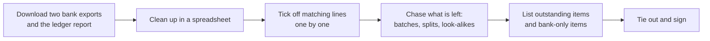
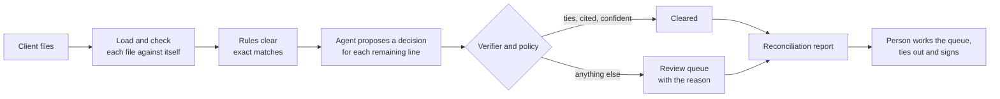

# Bank reconciliation agent

[](https://github.com/CJBachinski/bank-rec-agent/actions/workflows/tests.yml)

*A portfolio project, written as the memo I would hand a client's controller: workflow map, build, test results, rollout, return.*

**To:** Controller, Tallow Creek Supply Co.
**From:** Chris Bachinski
**Subject:** Can an AI agent take over the monthly bank reconciliation, and how far should we trust it?

> Tallow Creek Supply Co. is fictional and every transaction in this repository is synthetic. The data is built to behave like a real month end: two bank exports in different formats, a ledger report with its headers and totals left in, names that disagree between bank and books, and the usual errors. The models, code, tests and results are real. Every number below is generated from the results files in `evals/` by `scripts/build_readme.py`. I built this with Claude Code.

## 1. Bottom line

An agent built on {{deploy.model}} can do the part of the bank reconciliation that plain matching rules cannot, and in testing it never cleared a bank line against the wrong entry. I recommend a one-month shadow run before it is allowed to clear anything on its own.

| | Held-out month ({{test.month}}, {{test.bank_lines}} bank lines) |
|---|---|
| Bank lines settled correctly by matching rules alone | {{test.rules.correct}} |
| Bank lines settled correctly by rules plus the agent | {{test.v3.sonnet.correct}} over {{test.v3.sonnet.reps}} runs |
| Bank lines cleared against the wrong entry | {{test.v3.sonnet.false_clears}} |
| Hallucinations on the {{test.negatives}}-case trap set | {{test.v3.sonnet.hallucinated}} in {{test.v3.sonnet.neg_trials}} trials |
| API cost | {{test.v3.sonnet.cost_per_100}} per 100 bank lines |
| Model time for the month | {{test.v3.sonnet.month_minutes}} minutes |
| Staff time saved per month | {{timing.headline}} |


No configuration cleared a bank line against the wrong entry.

Three things to know before reading further:

1. **Zero is not a guarantee.** No wrong clears in {{test.v3.sonnet.agent_trials}} agent decisions means the true rate is probably below {{test.v3.sonnet.false_clear_upper}}, not that it is zero. Section 7 says what this evidence cannot show.
2. **The agent proposes; code decides.** The model has read-only access. A separate verifier checks every id, every quoted value and every sum before anything is cleared. Section 3 explains the split.
3. {{timing.note}}

## 2. Workflow map

### Today



Step C is mechanical. Step D is judgement: a card processor deposit that covers four sales less a fee, one ledger deposit that the bank shows as three, two payments of the same amount a day apart.

### Proposed



| Step | Today | Proposed | Who is accountable |
|---|---|---|---|
| Get the files into one shape | By hand | Code, with checks that refuse a file whose balances do not add up | Staff accountant |
| Exact matches | By hand | Rules: same amount, same account, dates within four days, one candidate each way; checks by number | Rules, reviewed once |
| Judgement matches | By hand | Agent proposes; verifier and policy decide | Staff accountant reviews the queue |
| Outstanding and bank-only lists | By hand | Generated | Staff accountant |
| Tie-out and sign-off | By hand | Generated report, signed by a person | Controller |

Nothing changes about who signs the reconciliation.

## 3. What was built

**Load and check.** Three inputs in three shapes go into one SQLite database. A bank export whose balance column does not follow from its amounts is refused, and so is a ledger whose total row disagrees with its lines.

**Rules first.** Two exact rules clear what cannot be argued with. A check number that agrees with a different amount goes to a person as a keying error. On {{test.month}} the rules settle {{test.rules.correct}} of bank lines and leave {{test.rules.left}}.

{{rules.table}}

**The agent.** For each line the rules leave, the model gets the bank line and three read-only tools: search open ledger entries, search open bank lines, and a calculator that adds up a group and says whether it ties. It returns one structured proposal: match, no match, or needs review, with the ids involved, the field values it relied on, and a confidence level. It cannot write to the books.

**The verifier.** Code checks the proposal before anything happens:

- every transaction id exists
- every quoted value equals the stored value, in a field that record has
- the group ties to the cent, computed in integer cents by code
- nothing in the group is already matched
- bank and ledger sides are in the same account
- a ledger check is only matched to the bank check with that number

**The policy.** A verified match is cleared only when the model reported {{policy.levels}} confidence, every bank line in the group independently proposed the same group, and no other proposal claims any of the same lines. Everything else goes to the review queue with the reason attached. A crash or a cut-off response leaves the line open; it is never recorded as "no match".

The policy level was chosen on the development month and applied unchanged to the held-out month:

{{policy.table}}

No policy caused harm on the development runs, so the choice came down to how many correct matches each one held back.

## 4. Test results

### 4.1 How it was tested

- **Two months of data.** September 2026 is the development month: prompts and the policy were tuned on it. The agent was not run on October 2026 until the prompt, the grader and the policy were frozen and committed. Reported numbers come from October.
- **An answer key that is true by construction.** The generator writes each month's data and its answer key from the same events, and tests confirm both accounts tie to the cent.
- **A trap set.** {{test.negatives}} small cases per month where the honest answer is "no" or "ask a person", plus {{test.controls}} real matches that look awkward, so that a model which says "no" to everything fails.
- **Repetition.** These models do not accept a temperature setting, so each configuration ran {{test.v3.sonnet.reps}} times and the spread is reported.
- **The harness was tested before the model was.** Four stand-in models went through the whole pipeline at no cost: one that reads the answer key (scores 100%), one that says "no" to everything, one that matches the first entry with the same amount, and one that invents entries. The grader caught each of them the way it should.
- **Grading is code.** No model grades another model.

Four outcomes are counted separately, because they do not cost the same: settled correctly; **false clear** (cleared against the wrong entry, the expensive one, because nobody looks at a cleared line again); left for a person; and filed under the wrong heading.

### 4.2 The held-out month

{{table.test_month}}

Rules alone settle {{test.rules.correct}}. The first prompt took {{deploy.model}} to {{test.v1.sonnet.correct_pct}}; the final prompt took it to {{test.v3.sonnet.correct_pct}}. No configuration produced a false clear. What the first prompt got wrong was mostly caution: it sent real matches to review. In one pattern it went further and filed one line of a split deposit as a deposit nobody had booked, which a person would have had to catch in the queue.

### 4.3 The hallucination test set

{{table.test_hallucination}}

A hallucination here means one of four things: calling a trap a match, naming a transaction that does not exist, quoting a value that differs from what is stored, or stating a dollar figure that cannot be derived from the data. A mislabelled citation (real text, cited under a field that record does not have) is counted beside them, not among them.

By kind of case, for {{deploy.model}} with the final prompt:

{{table.test_categories}}

**The cases that matter most.** In {{test.guard_blind}} of the {{test.negatives}} traps, one ledger entry ties to the cent but belongs to a different company. A wrong match there passes every arithmetic check, so only the model's judgement and the confidence policy stand in the way. Across the three models with the final prompt, that is {{test.final.blind_forced}} wrong matches in {{test.final.blind_trials}} trials, which bounds the true rate below about {{test.final.blind_upper}}. That is the weakest number in this memo and the reason for the shadow month.

For scale, the stand-in model that matches the first entry with the same amount forced a match on {{standin.greedy.blind_forced}} of those {{standin.greedy.blind_n}} cases, and {{standin.greedy.blind_escaped}} of them would have been cleared.

### 4.4 Prompt iteration

Three versions, each written in response to failures the previous one actually produced on the development month. The full log, with case ids, is in [prompts/CHANGELOG.md](prompts/CHANGELOG.md).

Development month, {{deploy.model}}:

{{table.prompts_dev_sonnet}}

Development month, Claude Haiku 5.5:

{{table.prompts_dev_haiku}}

The same comparison on the held-out month, which the prompts never saw.

Held-out month, {{deploy.model}}:

{{table.prompts_test_sonnet}}

Held-out month, Claude Haiku 5.5:

{{table.prompts_test_haiku}}

Version 2 told the agent three things about how this company's records behave (card purchases post under trade names, one deposit can appear as several bank lines, bills are sometimes entered twice). Version 3 fixed a citation fault that version 2 exposed on the smaller model. The gain held on the month the prompts had never seen.

### 4.5 Model comparison

Final prompt, held-out month, {{test.v3.sonnet.reps}} runs each. Prices are list prices as of {{prices.as_of}}.

{{table.models}}

**Recommendation: {{deploy.model}}.** With the final prompt the three models cannot be told apart on safety, and Haiku's one miss in {{test.v3.haiku.line_trials}} line-trials is within noise. The reason to prefer Sonnet is the first-prompt result: before the prompt described this company's patterns, Sonnet settled {{test.v1.sonnet.correct_pct}} and Haiku {{test.v1.haiku.correct_pct}}. Real data will contain patterns the prompt does not describe, and that is the condition the first prompt tested. At this volume the cost difference is cents per month. At tens of thousands of lines a month it would be worth re-running the comparison for Haiku.

### 4.6 Where it failed

Every failure, the reason, and what was done about it is in [docs/FAILURE_ANALYSIS.md](docs/FAILURE_ANALYSIS.md). The short version:

- The first prompt was too cautious about trade names, split deposits and duplicated entries. Fixed in the prompt.
- The smaller model cited real text under a field name that did not exist for that record. The verifier held every one. Fixed in the prompt, and the grader now reports this separately from an invented value.
- The rule's four-day window misses payments that post across a holiday weekend. Left as it is; those lines go to the agent.
- Reading the failures found two places where the grader, not the model, was wrong. Both were corrected before the held-out run. A third fault, in the verifier, turned up in the held-out run itself and changed no reported result.

## 5. Rollout

| Phase | What the agent may do | What a person does | Move on when |
|---|---|---|---|
| Month 1: shadow | Nothing. It runs beside the manual reconciliation. | Reconciles as today, then compares | Zero false clears, and every disagreement explained |
| Month 2: review everything | Proposes; nothing clears without a click | Reviews every proposal, cleared or not | Zero false clears across the month |
| Month 3 onward: auto-clear | Clears verified matches at {{policy.levels}} confidence | Works the review queue and signs | Stays here while the controls below hold |

Controls that stay in place:

- **Audit trail.** Every decision records its source (rule, agent or person), the entries involved, the agent's explanation and what the verifier said.
- **A sample of cleared lines is re-checked each month.** A cleared line is the one nobody looks at again, so a random sample is.
- **One false clear sends it back a phase.** The trap set is re-run before it moves forward again.
- **The trap set grows.** Every real failure becomes a new case.
- **Re-test on any model or prompt change.** The whole evaluation re-runs from one command per configuration.

What stays with a person: anything in the review queue, every journal entry, and the signature.

## 6. Return

**Time.**

{{timing.section}}

**Money.**

{{timing.roi}}

For one small company this is a modest sum. The case for the agent is volume: the same build, tested once per client, repeated across every account a firm reconciles each month.

The API cost on the other side of that is {{test.v3.sonnet.cost_per_100}} per 100 bank lines, which for this company is {{test.v3.sonnet.month_cost}} a month. The cost that matters is not the API. It is the review time, and the one-off work of testing the agent on each new client's data.

## 7. What this evidence cannot show

- **One fictional company.** The data is synthetic. Real exports will be messier in ways I did not think to generate.
- **The held-out month came from the same generator.** It is new data, not new kinds of problems. It shows the prompts did not memorise September; it does not show how the agent handles a pattern nobody described.
- **The test has stopped discriminating at the top.** Three models scoring {{test.v3.haiku.correct_pct}} to {{test.v3.opus.correct_pct}} means the set is too easy to rank them. Harder cases are the next thing to build.
- **Zeros have wide error bars.** {{test.v3.sonnet.hallucinated}} hallucinations in {{test.v3.sonnet.neg_trials}} trials bounds the rate below about {{test.v3.sonnet.hallucinated_upper}} for that model. Pooling every run in this repository ({{all.runs}} runs, {{all.neg_trials}} trials, {{all.hallucinated}} hallucinations) brings it below {{all.hallucinated_upper}}, but that mixes models and prompts, and repeated runs of the same case are not independent trials.
- **Small numbers behind each fix.** Each prompt change moved a handful of cases. The direction is clear; the size is not precise.
- {{timing.limit}}

## 8. Run it

```bash
uv sync
uv run pytest -q                                   # no API key needed
uv run python scripts/make_dataset.py --check      # data and answer key match the generator
uv run python scripts/rules_baseline.py            # rules only, both months
uv run python -m evals.run --name harness-oracle --split dev --model oracle   # free harness check
uv run python -m evals.summarize evals/runs/{{deploy.run}} --policy {{policy}}   # re-grade a saved run
uv run python scripts/reconcile.py --month {{test.month}} --from-run {{deploy.run}}   # rebuild its reconciliation
uv run python scripts/build_readme.py --check      # README matches the results files
```

The same four checks run on every push, with no API key, in [GitHub Actions](.github/workflows/tests.yml).

A paid run needs `ANTHROPIC_API_KEY` in the environment. I keep it in a secrets manager and inject it per command:

```bash
doppler run --only-secrets ANTHROPIC_API_KEY -- uv run python -m evals.run --name my-run --split test --prompt v3 --model claude-sonnet-5-5 --reps 3
```

The evaluation runs behind this memo cost {{spend.total}} in API usage.

| Where | What |
|---|---|
| `data/` | Client files for both months and the answer keys |
| `recon/` | Loader, rules, agent, verifier, pipeline policy, report |
| `sql/schema.sql` | Tables and the views behind the reconciliation |
| `prompts/` | Three prompt versions and the changelog |
| `evals/` | Trap set, grader, run harness, stand-in models, saved runs |
| `scripts/` | Dataset generator, baseline, timing sessions, this README's builder |
| `tests/` | Tests for every module; they run without a model |
| `docs/` | Failure analysis, the requirement map, and a [sample reconciliation](docs/sample/reconciliation.md) as the agent produced it |
